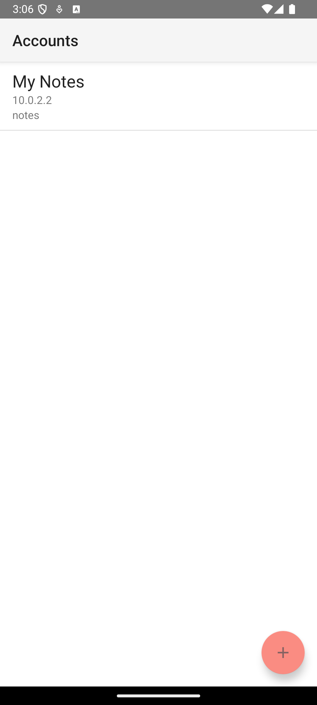
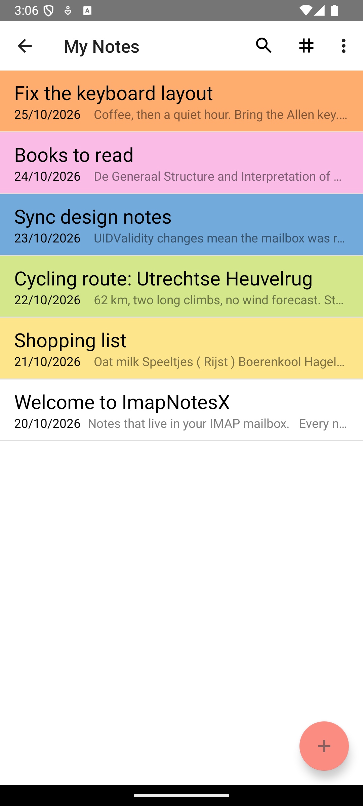
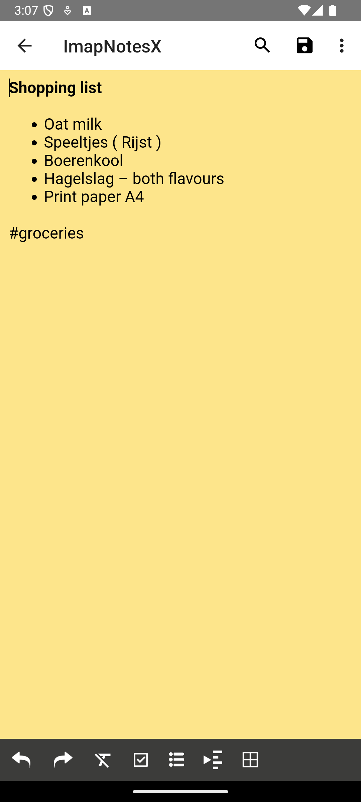
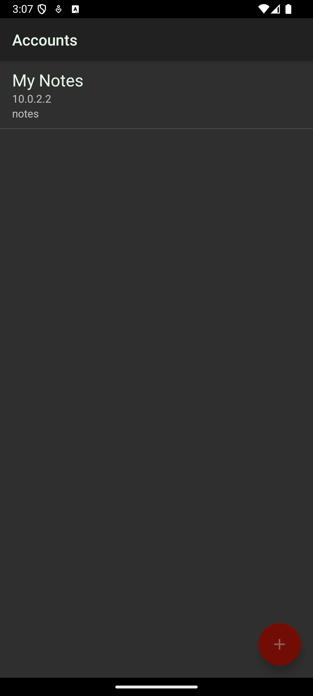
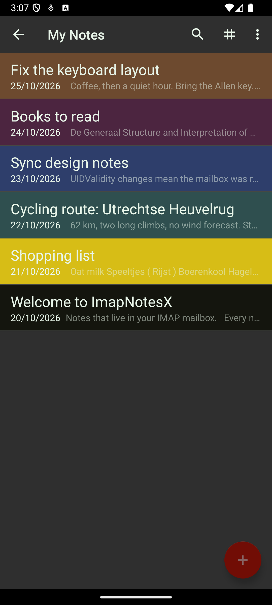
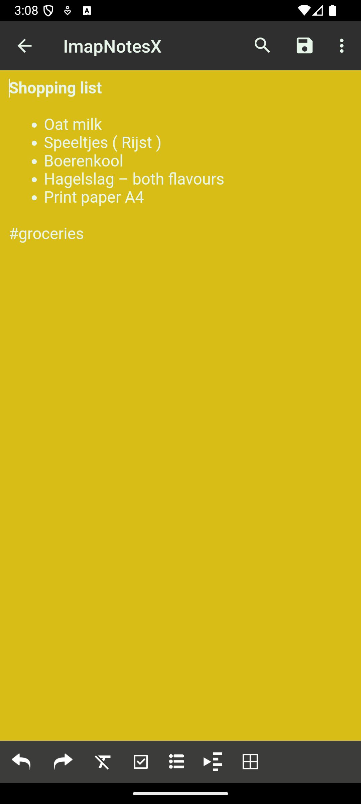

# ImapNotesX

**Notes that live in your IMAP mailbox.** A free and open source Android app for notes and
checklists, synchronized as standard HTML e-mail in the *Apple Notes* wire format — so the same
mailbox works with Apple devices, with Thunderbird, and with other IMAP clients.

[](https://f-droid.org/en/packages/nl.enimatek.imapnotesx/)
<!-- the F-Droid link goes live as soon as the first fdroiddata merge request is built -->

ImapNotesX is a community fork of [ImapNotes3](https://github.com/niendo1/ImapNotes3) (GPLv3) with
its own name, package id and logo. It installs side by side with the original and talks to the same
mailboxes; the wire format has not changed.

## Screenshots

| Accounts | Notes | Editor |
| :--: | :--: | :--: |
|  |  |  |
|  |  |  |

## Features

### IMAP-based synchronisation

- Works with any IMAP server (self-hosted or commercial).
- Notes are stored as HTML e-mails with the Apple Notes headers
  (`X-Uniform-Type-Identifier: com.apple.mail-note`), so nothing is locked in.
- Background synchronisation at a chosen interval through the Android sync adapter.
- Multiple accounts, each with its own IMAP folder and its own notes list.
- Share text, images and e-mails from any app into the mailbox.

### Notes and lists

- Rich text editor: bold, italic, underline, headings, lists, checkboxes, tables, links, images.
- Nine note background colours, remembered per note.
- Tags: write `#hashtags` in a note, filter and search by them.
- Sort by date, title or colour; full-text search.
- Share a note as text or as the original `.eml` file.
- Backup and restore to a zip archive.

### Accounts first

The app opens on the account overview; every notes screen belongs to exactly one account. Account
setup checks the IMAP connection before anything is written, and explains what failed.

## Privacy

No trackers, no analytics, no accounts other than your own IMAP credentials. Everything is stored
either on the device or in your mailbox — you keep the only copy that matters.

## Download and build

- **Install:** the [F-Droid entry](https://f-droid.org/en/packages/nl.enimatek.imapnotesx/)
  (signed by F-Droid, auto-updated) or a release APK from
  [Releases](https://github.com/enimatek-nl/ImapNotesX/releases).
- **Build:** `./gradlew assembleDebug` — needs an Android SDK with `compileSdk 37`
  (`ANDROID_HOME` or `local.properties`) and JDK 17+.

## Translations

Fifteen translations plus the English base, maintained directly in this repository: edit
`ImapNotesX/src/main/res/values-<locale>/strings.xml` and open a pull request. The base string set
is `ImapNotesX/src/main/res/values/strings.xml`; untranslated strings fall back to English.

## License

GPL-3.0-only. See [LICENSE](LICENSE).

## Credits

- Fork lineage: **imapnote** → [nbenm/ImapNote2](https://github.com/nbenm/ImapNote2) →
  [kwhitefoot/ImapNote2](https://github.com/kwhitefoot/ImapNote2) →
  [niendo1/ImapNotes3](https://github.com/niendo1/ImapNotes3) → **ImapNotesX**.
- Based in part on [ImapNote by axiomat](https://github.com/axiomat/ImapNote)
  (BSD-licensed).
- The [iOS IMAP Notes](https://github.com/padj/ThunderBird-IMAP_Notes) Thunderbird add-on by
  Patrick Schuster for the reverse-engineered wire format.
- [RichEditor-Android](https://github.com/wasabeef/richeditor-android) and the
  [niendo1 fork](https://github.com/niendo1/richeditor-android) used for the editor.

## Development

```sh
./gradlew assembleDebug              # build the debug APK
./gradlew lintDebug                  # lint report (MissingTranslation noise is expected)
python3 scripts/mock_imap_server.py --port 1143 &   # local test mailbox, see AGENTS.md
python3 scripts/dev_setup_account.py --reinstall --name "My Notes"
python3 scripts/dev_screenshots.py   # regenerate the store screenshots
```

Branches: `main` is what ImapNotesX ships; `upstream-pr` carries only the changes meant for
niendo1/ImapNotes3. Releases are tagged on `main`, built by GitHub Actions and picked up by
F-Droid — see [docs/FDROID.md](docs/FDROID.md).
